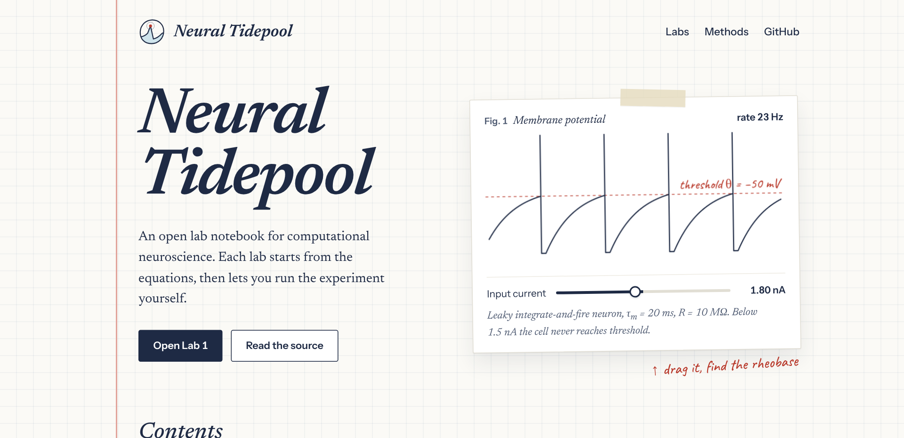
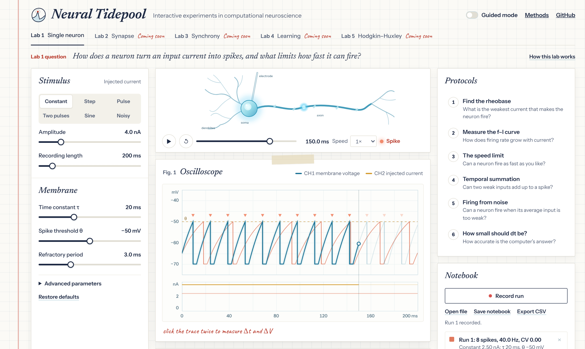

<p align="center">
  
</p>

<h1 align="center">Neural Tidepool</h1>

<p align="center">Interactive experiments in computational neuroscience</p>

<p align="center">
  <a href="https://github.com/Yunmo0121/Neural-Tidepool/actions/workflows/tests.yml"></a>
  <a href="https://yunmo0121.github.io/Neural-Tidepool/"></a>
  <a href="LICENSE"></a>
</p>

<p align="center">
  <a href="https://yunmo0121.github.io/Neural-Tidepool/"><b>Open the lab</b></a> &nbsp;|&nbsp;
  <a href="https://yunmo0121.github.io/Neural-Tidepool/methods.html">Methods</a> &nbsp;|&nbsp;
  <a href="#quick-start">Quick start</a>
</p>



## What it is

Neural Tidepool is a laboratory for computational neuroscience that runs in the browser. Each lab poses a scientific question, gives you a model to experiment on, and provides the instruments to measure what happens.

**Lab 1** asks: *how does a neuron turn an input current into spikes, and what limits how fast it can fire?* You stimulate a leaky integrate-and-fire neuron, watch its membrane voltage on an oscilloscope, record runs in a notebook, and compare what you measure with exact theory.

The site is designed as an open lab notebook: graph paper, figures taped onto the page, and notes in red pen.

It is written for students meeting neuron models for the first time, and for anyone who wants to check the numbers: every result is computed exactly, documented and reproducible.

## Lab 1: Single neuron




- **Stimulus.** Six input currents: constant, step, pulse, two pulses, sine, and coloured noise with a fixed random seed.
- **Oscilloscope.** Membrane voltage and injected current on two channels, synchronised with an animated neuron, with A/B cursors for measuring time and voltage differences.
- **Readouts.** Spike count, mean rate, ISI rate, coefficient of variation, first-spike latency and rheobase, each labelled with its definition and shown as n/a when it is undefined.
- **Analysis.** The simulated f–I curve plotted against its exact formula, and the time-step accuracy of two numerical methods.
- **Six guided protocols.** Find the rheobase, measure the f–I curve, the refractory speed limit, temporal summation, firing from noise, and how small the time step should be. Each one asks for a prediction first and ends with an explanation and textbook references.
- **Notebook.** Record runs, overlay them on the oscilloscope, restore any run exactly, save experiment files and notebooks, and export CSV.
- **Guided mode.** Short red-pen notes beside every parameter and instrument, like annotations in a lab notebook, for first-time users.

## Why you can trust the numbers

**Exact integration.** Between spikes the LIF equation is linear and is solved in closed form, $V(t+h) = V_\infty + (V(t) - V_\infty)\,e^{-h/\tau_m}$. Threshold crossings are located exactly, and the refractory period starts at the exact spike time, so nothing is rounded to the time grid. The measured error in spike times is around $10^{-13}$ ms, which is floating-point rounding. Forward Euler is included for comparison.

**Two independent implementations.** The simulator exists twice: in JavaScript for the browser ([`docs/js/lif.js`](docs/js/lif.js)) and in Python ([`neuron.py`](neuron.py)). A parity test runs every waveform with both integrators, two time steps and two refractory periods in both languages, and requires them to agree to within $10^{-9}$.

**Checked against theory.** The tests compare the simulation with exact results: the rheobase, the first-spike time, the f–I curve (to six decimal places) and the first-order convergence of Euler's method.

**Reproducible.** Every recorded run is saved as an experiment file holding every parameter, the random seed, the time step, the integrator, the engine version and the spike times. Any experiment file can be re-run outside the browser:

```console
$ python reproduce.py neural-tidepool-run-1.json
Spikes:         recorded 8, reproduced 8
Max difference: 0.000e+00 ms
Result:         REPRODUCED
```

**Documented.** The [Methods](https://yunmo0121.github.io/Neural-Tidepool/methods.html) page gives the model, the numerical scheme, every stimulus formula, the definition of every measurement, the parameter table and the known limitations.

**Tested on every push** with GitHub Actions.

## Quick start

### Use it online

Open **[yunmo0121.github.io/Neural-Tidepool](https://yunmo0121.github.io/Neural-Tidepool/)**. Nothing to install.

### Run it locally

```bash
git clone https://github.com/Yunmo0121/Neural-Tidepool.git
cd Neural-Tidepool
python -m http.server --directory docs 8000
```

Then open `http://localhost:8000` for the home page, or `http://localhost:8000/lab1.html` for Lab 1. The page must be served over HTTP, because browsers do not load JavaScript modules from `file://`.

### Reproduce an experiment in Python

```bash
pip install numpy
python reproduce.py path/to/experiment.json            # compare with the recorded spike times
python reproduce.py path/to/experiment.json --csv out.csv  # also write the trace
```

### Run the tests

```bash
python -m unittest discover -s tests -v   # Python engine, theory, parity, reproduction
node --test tests/js/*.test.js            # JavaScript engine
```

The cross-language tests need Node.js and are skipped without it.

### Python edition

The original Streamlit interface is kept as a compact Python companion to the browser lab. It simulates a single neuron with constant input.

```bash
python -m venv .venv
source .venv/bin/activate        # Windows: .venv\Scripts\activate
pip install -r requirements.txt
streamlit run app.py
```

## The model

Lab 1 uses the leaky integrate-and-fire neuron:

$$
\tau_m \frac{dV}{dt} = V_{\mathrm{rest}} - V + R\,I(t)
$$

When $V$ reaches the threshold $\theta$, a spike is recorded, $V$ is reset to $V_{\mathrm{reset}}$ and held there for the refractory period $t_{\mathrm{ref}}$. With the default parameters ($\tau_m = 20$ ms, $\theta = -50$ mV, $V_{\mathrm{rest}} = -65$ mV, $V_{\mathrm{reset}} = -70$ mV, $R = 10$ MΩ, $t_{\mathrm{ref}} = 3$ ms) the neuron starts firing above 1.5 nA and fires at about 40 Hz at 2.5 nA. The [Methods](https://yunmo0121.github.io/Neural-Tidepool/methods.html) page has the full details.

## Project structure

```text
Neural-Tidepool/
├── docs/                    The browser lab, served by GitHub Pages
│   ├── index.html           Home page: the notebook's cover and contents
│   ├── lab1.html            Lab 1: Single neuron
│   ├── methods.html         Methods: model, numerics, definitions, parameters
│   ├── js/
│   │   ├── lif.js           Simulation engine, stimuli and theory
│   │   ├── experiment.js    Experiment and notebook file formats
│   │   ├── protocols.js     Guided experiments
│   │   ├── home.js          Live figure on the home page
│   │   └── app.js           Instruments and interface
│   ├── css/                 Styles (notebook.css holds the lab-notebook theme)
│   ├── assets/              Logo and screenshot
│   └── vendor/              KaTeX and fonts, bundled so the site works offline
├── neuron.py                Python reference engine
├── stimulus.py              Stimulus waveforms, identical to the browser's
├── reproduce.py             Re-run an experiment file in Python
├── app.py                   Streamlit Python edition
├── neuron_animation.py      Animation for the Python edition
├── tests/                   Python and JavaScript tests
└── .github/workflows/       Continuous integration
```

## Roadmap

| Lab | Question | Status |
| --- | --- | --- |
| 1. Single neuron | How does a neuron turn an input current into spikes? | Available |
| 2. Synapse | How does one neuron pass a signal to another? | Planned for v0.4 |
| 3. Synchrony | Why do coupled neurons fall into step? | Planned for v0.4 |
| 4. Learning | How can spiking networks learn, through STDP and through surrogate gradients? | Planned for v0.5 |
| 5. Hodgkin–Huxley | Where do spikes come from, in terms of ion channels? | Planned for v1.0 |

Still to come for Lab 1: a validation page that checks every analytic result live, golden-file regression tests, and a more detailed neuron illustration.

<details>
<summary>Version history</summary>

- **v0.3.1**: lab-notebook redesign with a home page, exact event-driven engine, reproducible experiment files and notebook, Python reproduction script, Methods page, guided mode.
- **v0.3**: the browser lab bench, with stimulus waveforms, oscilloscope, notebook, protocols and analysis.
- **v0.2**: an animated neuron whose glow follows the simulated spikes.
- **v0.1**: a Streamlit app simulating a leaky integrate-and-fire neuron.

</details>

## References

- W. Gerstner, W. M. Kistler, R. Naud and L. Paninski, *[Neuronal Dynamics: From Single Neurons to Networks and Models of Cognition](https://neuronaldynamics.epfl.ch/online/)*, Cambridge University Press, 2014. Lab 1 follows §1.3 (integrate-and-fire models), §7.3 (interval distributions) and §8.1 (noise input).
- D. T. Gillespie, Exact numerical simulation of the Ornstein–Uhlenbeck process and its integral, *Physical Review E* 54, 2084 (1996).
- The full list is on the [Methods](https://yunmo0121.github.io/Neural-Tidepool/methods.html#references) page.

## About

Neural Tidepool began, under the name NeuroVerse, as a small personal project driven by curiosity about computational neuroscience.

I'm a computer science student interested in how mathematics and programming can help us understand biological systems. This project is where I practise that: mathematical modelling, numerical methods, scientific visualisation, testing, and explaining science through software. One of my favourite parts is watching an abstract equation become something you can poke at and see respond.

I hope Neural Tidepool keeps growing, one lab at a time, into a place where anyone can experiment with neural models and trust what they see. Thanks for visiting!

## License and citation

Neural Tidepool is released under the [MIT License](LICENSE). It bundles [KaTeX](https://katex.org) (MIT License) and the Instrument Sans and Newsreader fonts (SIL Open Font License 1.1); their licences are included in `docs/vendor/`.

If you use Neural Tidepool in teaching or research, please cite it. GitHub's **Cite this repository** button gives the reference from [`CITATION.cff`](CITATION.cff), or use:

```bibtex
@software{li_neural_tidepool_2026,
  author  = {Li, Yunmo},
  title   = {Neural Tidepool: interactive experiments in computational neuroscience},
  year    = {2026},
  version = {0.3.1},
  url     = {https://github.com/Yunmo0121/Neural-Tidepool}
}
```
